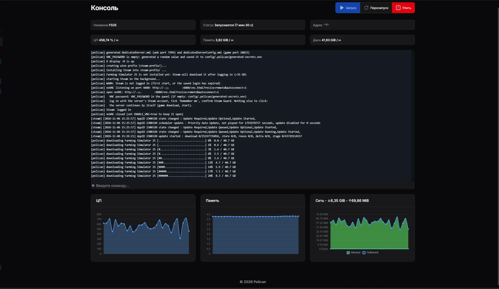
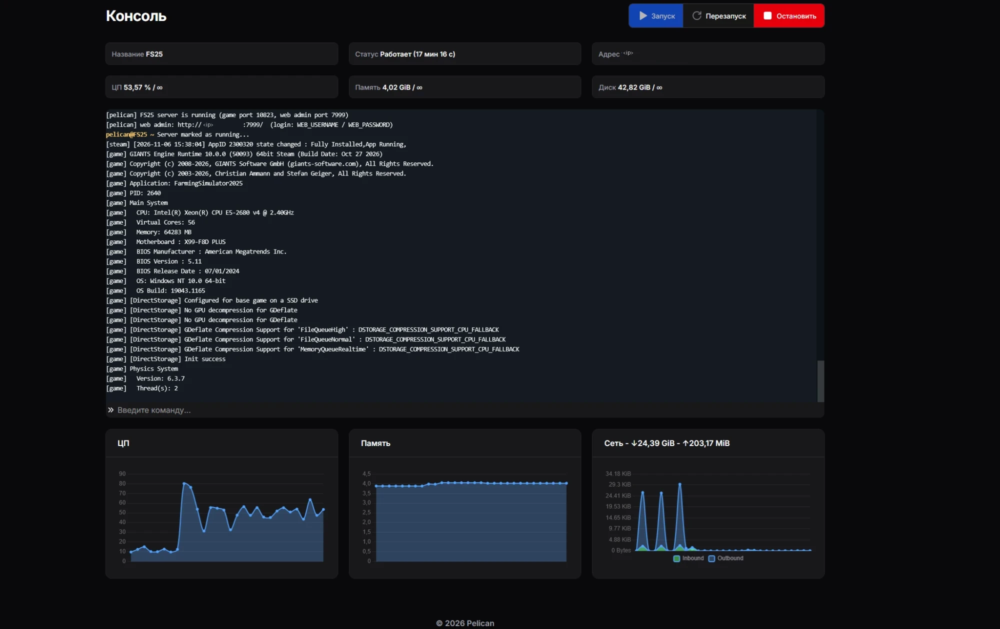

# Farming Simulator 25 for Pelican

English | **[Русский](README.ru.md)**

Egg and Docker image for a Farming Simulator 25 dedicated server running under wine in [Pelican](https://pelican.dev).

* **Steam copy (default):** log in to Steam once in the browser (noVNC). After that the server downloads the game
  and DLC by itself, installs updates and starts. Download progress is shown in the panel console.
* **GIANTS copy:** install with your own key via noVNC.
* All settings are egg variables; the game configs are regenerated on every start.
* The game log (mods, map loading, players) is shown in the Pelican console. Optional: save before every stop (`SAVE_ON_STOP=true`).

> This project is not affiliated with GIANTS Software or Valve. The image does not contain the game: everyone installs their own copy.
> The server needs a **separate licence**: a second Steam account with its own copy of FS25, or a separate GIANTS key.
> You cannot play and run the server on the same licence at the same time.

## Requirements

* Pelican Panel + Wings, Linux x86_64 node. 60 GB disk or more, 8 GB RAM or more.
* **Node setting (required).** Wine keeps shared memory in `/tmp`, and Wings mounts `/tmp` as a 100 MB tmpfs.
  Steam and the game crash with that. In the node's `/etc/pelican/config.yml`:
  ```yaml
  docker:
    tmpfs_size: 2048
    container_pid_limit: 2048
  ```
  Then `systemctl restart wings`. If `/tmp` is smaller than 1 GB, the script prints a warning in the console.
* Three allocations per server: game, web admin, noVNC.

## Quick start (Steam)

1. **Import the egg:** Admin → Eggs → Import → URL:
   `https://raw.githubusercontent.com/IRRITANTS/pelican-fs25/main/egg/egg-farming-simulator-25.json`
   (or upload the file `egg/egg-farming-simulator-25.json`).
2. **Server:** create a server with this egg and three allocations.
   | Purpose | Allocation | Variable |
   |---|---|---|
   | Game (TCP+UDP) | primary | `SERVER_PORT` (set by Wings) |
   | Web admin | additional | `WEB_PORT` = the number of this allocation |
   | noVNC | additional | `VNC_PORT` = the number of this allocation, not 5900 |

   Wings forwards the port with the same number into the container, so `WEB_PORT` and `VNC_PORT` must match
   the numbers of the additional allocations. Pelican does not link them automatically: enter the numbers yourself.
   The game allocation must be the primary one, e.g. 10823. If 7999 became primary, make the game allocation
   primary in the server's Network tab (Make Primary).
3. **Start:** when the server is created, the install script runs (downloads `SteamSetup.exe`). Press Start. The console shows:
   ```
   [pelican] WARN: Steam is not logged in (first start, or the saved login has expired)
   [pelican] open noVNC: http://<ip>:<VNC_PORT>/vnc.html?resize=remote&autoconnect=1
   ```
   noVNC password: the `VNC_PASSWORD` variable. If it is empty, a password is generated and stored
   in `config/.pelican/generated-secrets.env` (Files tab).
4. **Steam login:** in the noVNC window log in to the **server** Steam account, tick "Remember me", confirm Steam Guard.
   Nothing else is needed. The server detects the login, closes noVNC and starts downloading the game (~41 GB):
   ```
   [pelican] downloading Farming Simulator 25 [##########....................] 34%  14.0 / 40.7 GB
   ```
   
5. When the download finishes, the server starts the web admin and the game. It is ready when the console shows
   `[pelican] FS25 server is running` and the game log shows `[game] ... Entered Gameplay`. While the map is loading,
   the server is not in the server list and nobody can join.
   Loading runs on the CPU, almost on a single core, so the time depends on core speed and on the map. On a Xeon E5-2680 v4
   mapEU takes ~6.5 min and Riverbend Springs (MapUS) ~11 min. Do not press Stop/Start in the web admin while it loads,
   or loading starts over. Once the server is running, players join quickly.
   Web admin: `http://<ip>:<WEB_PORT>/`. Login `WEB_USERNAME`, password `WEB_PASSWORD`; if the password is empty, it is
   generated and stored in `generated-secrets.env`.
   

After that the Steam login is kept (for months). Game updates and new DLC are installed automatically on every server start.

Why there is no Steam login and password in the variables: since 2023 the Steam client no longer accepts `-login`
on the command line, and the game does not run without the client. Also, a password in panel variables is visible
in the Startup tab and in `docker inspect`.

## GIANTS option (your own key)

1. `GAME_SOURCE=giants`, `SERVER_MODE=install`.
2. Upload the game image to `installer/` (`FarmingSimulator25_*_ESD.img`, `.zip`, `.7z` or an unpacked `Setup.exe`) and DLC to `dlc/`
   (`FarmingSimulator25_<name>_*.exe` or archives) via SFTP or the file manager. Then press **Reinstall**:
   the install script unpacks the archives and does not touch the game, saves or config. Or set `INSTALLER_URL` and Reinstall downloads the archive itself.
3. Start the server, open the noVNC link from the console and double-click **Setup / Update FS25** on the desktop
   (if XFCE asks about an "untrusted launcher", press Launch). Setup installs the game, runs it once so you can enter the key,
   installs DLC from `dlc/` and checks for updates: answer "No" to the GPU driver warning, close the game in the main menu.
   Setup output is mirrored to the panel console.
4. `SERVER_MODE=server`, restart.

New DLC or an update: put the files into `dlc/`, then `install` → Setup → `server` again.

## Variables

| Variable | Default | What it does |
|---|---|---|
| `GAME_SOURCE` | `steam` | `steam` or `giants` |
| `SERVER_MODE` | `server` | `server`: the server; `install`: noVNC desktop for manual work; `web_only`: web admin only |
| `SERVER_NAME`, `SERVER_PASSWORD`, `SERVER_ADMIN` | | name in the server browser, join password, in-game admin password (empty = generate) |
| `SERVER_PLAYERS`, `SERVER_REGION`, `SERVER_MAP`, `SERVER_DIFFICULTY` | 16, en, MapUS, 3 | slots, language, map, economic difficulty |
| `SERVER_PAUSE`, `SERVER_SAVE_INTERVAL`, `SERVER_CROSSPLAY` | 2, 180, true | pause when empty, autosave (minutes), crossplay |
| `WEB_USERNAME`, `WEB_PASSWORD`, `WEB_PORT` | admin, empty, 7999 | web admin |
| `VNC_PASSWORD`, `VNC_PORT`, `ENABLE_VNC` | empty, 6080, false | noVNC; `ENABLE_VNC=true` keeps noVNC open in server mode too |
| `SAVE_ON_STOP` | false | `true`: save the game before stopping (installs the FS25_PelicanSave mod); `false`: no mod |
| `GAME_LOG` | filtered | game log in the console: `filtered`, `all`, `off` |
| `SERVER_DLC` | none | `none`: you enable DLC yourself in the web admin; `all`: enable all on autostart; or a list |
| `INSTALLER_URL` | | direct link to the GIANTS game image for Reinstall |

Empty passwords are generated on the first start and stored in `config/.pelican/generated-secrets.env`. They are never written to the log.

## DLC and mods

* **Steam:** Steam downloads all DLC owned by the server Steam account. To add a new DLC, buy it on the server account and restart the server.
* DLC are enabled in the web admin (Mods → Activate); the selection is kept between restarts.
  DLC are not downloaded to players from the server like mods, so only players who own all enabled DLC can join.
* **Mods:** `config/FarmingSimulator2025/mods/` or upload via the web admin, enable them there too.
* Saves, licence, GIANTS DLC: `config/FarmingSimulator2025/`. GIANTS game: `game/`. Steam and the Steam game: `steam-prefix/`.

## Stopping and saving

The egg's stop command is `stop` (via stdin). The script presses Stop in the web admin, closes Steam and wine.
FS25 itself closes without saving on Stop, and there is no Save button in the web admin. By default (`SAVE_ON_STOP=false`)
the game is saved only by autosave (`SERVER_SAVE_INTERVAL`, in minutes): anything after the last autosave is lost on stop.
Use a short interval, e.g. 30.

`SAVE_ON_STOP=true` puts a small server mod `FS25_PelicanSave` into `mods/` (4 KB, players download it automatically,
it does nothing on the client) and enables it on autostart. Then before stopping, the script asks the mod to save the game
and waits for the files to be written (~10 s):
```
[pelican] saving the game...
[pelican] game saved (12s)
```
With `SAVE_ON_STOP=false` the script removes this mod from `mods/`.

Console commands: `stop`, `save` (save now, only with `SAVE_ON_STOP=true`), `status`.

## Console

| Prefix | Source |
|---|---|
| `[pelican]` | the script: configs, Steam, start, stop, saving |
| `[steam]` | Steam messages about downloading and updating the game |
| `[autostart]`, `[webadmin]` | pressing Start/Stop in the web admin, active mods |
| `[DD/Mon/YYYY:...]` | web admin log |
| `[game] HH:MM:SS ...` | the game's own log: mods, map loading, `Entered Gameplay`, players, errors |

## Building the image yourself

The image is built from `docker/` without third-party server images: Arch Linux (Arch Linux Archive snapshot of 2025-11-13),
wine-staging 10.1, TigerVNC, noVNC 1.6.0 and websockify 0.13.0 (official releases, sha256-checked), XFCE, Node.js.
```bash
docker build -t pelican-fs25:latest docker/
```
Ready-made image: `ghcr.io/irritants/pelican-fs25:latest` (and `:YYYYMMDD`). It is built and published by
`.github/workflows/build.yml` on push to `main`. In a fork it is built as `ghcr.io/<your name>/pelican-fs25`;
after the first build make the package public: Packages → pelican-fs25 → Package settings → Change visibility → Public.

The egg is built from `egg/egg.template.json` and `egg/install.sh`:
```powershell
powershell -File egg/build-egg.ps1 -Image ghcr.io/irritants/pelican-fs25:latest -Author 33460433+IRRITANTS@users.noreply.github.com -UpdateUrl https://raw.githubusercontent.com/IRRITANTS/pelican-fs25/main/egg/egg-farming-simulator-25.json
```

The image works with any node uid/gid and with a read-only root filesystem, the way Wings runs it.

## Tested

Pelican + Wings, Steam copy, 2026-11-06:

| Test | Result |
|---|---|
| Empty volume, uid 1234 | Steam downloaded and installed, noVNC link in the console, noVNC responds, desktop and Steam window running |
| Saved Steam login, uid 999 | `Steam: logged in`, `installed and up to date`, web admin, Start, both DLC and the mod loaded, `Entered Gameplay` after ~8 min, 0 errors in the game log |
| `save` command | `Game saved successfully (savegame1)`, 12 s |
| Stop via `stop` and via SIGTERM | save (11 s), Stop in the web admin, Steam shutdown, `stopped.` in 35 s, exit code 0 |
| Changing variables | changes shown in the console (`config change: ...`), passwords hidden, special characters escaped |
| Reinstall | game, Steam login and saves untouched |
| Fresh install "as a regular user" | egg import, new server, Steam login, game download, mods, gameplay and saving all work |

Not tested: the GIANTS option in this image.

## Legal

* This is an unofficial project; it is not affiliated with or endorsed by GIANTS Software or Valve.
  Farming Simulator is a trademark of GIANTS Software GmbH, Steam is a trademark of Valve Corporation.
  The names are used only to say which game this server is for.
* The repository and the image contain no game files, no Steam client, no keys and no DLC. Everyone downloads the game
  from their own Steam account or installs it with their own GIANTS key. The server needs a separate licence for the game (and DLC).
* The Steam client is downloaded from Valve's servers (`SteamSetup.exe`) onto the server volume during installation.
* The `FS25_PelicanSave` mod was written for this project and is distributed for free, as FS25 mods should be.
* The software is provided "as is", without warranty (see [LICENSE](LICENSE)). Back up your saves yourself.

## Third-party components

The code in this repository: MIT, see [LICENSE](LICENSE). The image includes unmodified third-party software under its own licences:

| Component | Licence | Source |
|---|---|---|
| Wine-staging 10.1 | LGPL-2.1 | <https://gitlab.winehq.org/wine/wine-staging> |
| TigerVNC | GPL-2.0 | <https://github.com/TigerVNC/tigervnc> |
| noVNC 1.6.0 | MPL-2.0 | <https://github.com/novnc/noVNC> |
| websockify 0.13.0 | LGPL-3.0 | <https://github.com/novnc/websockify> |
| XFCE, bash, coreutils etc. | GPL / own | Arch Linux packages |

All Arch packages come from the Arch Linux Archive snapshot of 2025-11-13, so the versions are exact and reproducible.
Source of each package: `https://gitlab.archlinux.org/archlinux/packaging/packages/<package name>`.
List of packages with versions in the image: `docker run --rm --entrypoint pacman ghcr.io/irritants/pelican-fs25 -Q`.
