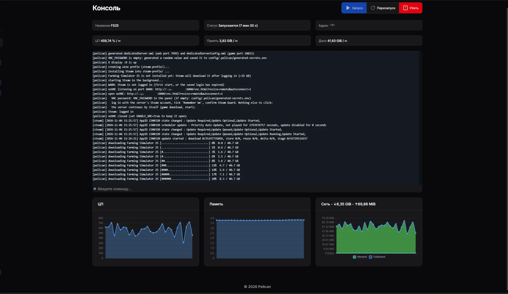
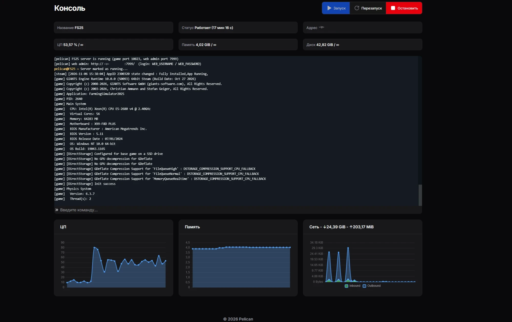

# Farming Simulator 25 для Pelican

**[English](README.md)** | Русский

Яйцо и Docker-образ для выделенного сервера Farming Simulator 25 под wine в [Pelican](https://pelican.dev).

* **Steam-копия (по умолчанию):** один раз войти в Steam через браузер (noVNC). Дальше сервер сам скачивает игру
  и DLC, ставит обновления и запускается. Прогресс скачивания видно в консоли панели.
* **GIANTS-копия:** установка со своим ключом через noVNC.
* Все настройки задаются переменными яйца, конфиги игры пересобираются при каждом старте.
* Лог игры (моды, загрузка карты, игроки) виден в консоли Pelican. По желанию: сохранение перед каждой остановкой (`SAVE_ON_STOP=true`).

> Проект не связан с GIANTS Software и Valve. Игру образ не содержит: каждый ставит свою копию сам.
> Для сервера нужна **отдельная лицензия**: второй Steam-аккаунт со своей копией FS25 или отдельный ключ GIANTS.
> Играть и держать сервер на одной лицензии одновременно нельзя.

## Требования

* Pelican Panel + Wings, нода Linux x86_64. Диск от 60 ГБ, RAM от 8 ГБ.
* **Настройка ноды (обязательно).** Wine держит общую память в `/tmp`, а Wings монтирует `/tmp` как tmpfs на 100 МБ.
  Steam и игра с этим падают. В `/etc/pelican/config.yml` ноды:
  ```yaml
  docker:
    tmpfs_size: 2048
    container_pid_limit: 2048
  ```
  Затем `systemctl restart wings`. Если `/tmp` меньше 1 ГБ, скрипт предупреждает об этом в консоли.
* Три аллокации на сервер: игра, веб-админка, noVNC.

## Быстрый старт (Steam)

1. **Импорт яйца:** Admin → Eggs → Import → URL:
   `https://raw.githubusercontent.com/IRRITANTS/pelican-fs25/main/egg/egg-farming-simulator-25.json`
   (или загрузите файл `egg/egg-farming-simulator-25.json`).
2. **Сервер:** создайте сервер на этом яйце с тремя аллокациями.
   | Назначение | Аллокация | Переменная |
   |---|---|---|
   | Игра (TCP+UDP) | основная | `SERVER_PORT` (Wings подставляет сам) |
   | Веб-админка | дополнительная | `WEB_PORT` = номер этой аллокации |
   | noVNC | дополнительная | `VNC_PORT` = номер этой аллокации, не 5900 |

   Wings пробрасывает порт с тем же номером внутрь контейнера. Поэтому `WEB_PORT` и `VNC_PORT` должны совпадать
   с номерами дополнительных аллокаций. Автоматически Pelican их не связывает, впишите номера сами.
   Основной (Primary) должна быть аллокация игры, например 10823. Если основной стала 7999, сделайте игровую
   основной во вкладке Network сервера (Make Primary).
3. **Запуск:** при создании сервера отработает install-скрипт (скачает `SteamSetup.exe`). Нажмите Start. В консоли:
   ```
   [pelican] WARN: Steam is not logged in (first start, or the saved login has expired)
   [pelican] open noVNC: http://<ip>:<VNC_PORT>/vnc.html?resize=remote&autoconnect=1
   ```
   Пароль noVNC: переменная `VNC_PASSWORD`. Если она пустая, пароль сгенерирован и лежит
   в файле `config/.pelican/generated-secrets.env` (вкладка Files).
4. **Вход в Steam:** в окне noVNC войдите в **серверный** Steam-аккаунт, отметьте «Запомнить меня», подтвердите Steam Guard.
   Больше ничего нажимать не надо. Сервер сам увидит вход, закроет noVNC и начнёт качать игру (~41 ГБ):
   ```
   [pelican] downloading Farming Simulator 25 [##########....................] 34%  14.0 / 40.7 GB
   ```
   
5. Когда игра скачана, сервер запустит веб-админку и игру. Готово, когда появится строка `[pelican] FS25 server is running`,
   а в логе игры `[game] ... Entered Gameplay`. Пока карта грузится, сервера нет в списке и войти нельзя.
   Загрузка идёт на процессоре, почти на одном ядре, так что время зависит от скорости ядра и от карты. На Xeon E5-2680 v4
   mapEU грузится ~6,5 мин, Riverbend Springs (MapUS) ~11 мин. Не нажимайте Stop/Start в веб-админке во время загрузки,
   иначе она начнётся заново. Когда сервер работает, игроки заходят быстро.
   Веб-админка: `http://<ip>:<WEB_PORT>/`. Логин `WEB_USERNAME`, пароль `WEB_PASSWORD`; если пароль пустой, он
   сгенерирован и лежит в `generated-secrets.env`.
   

Дальше вход в Steam сохраняется (месяцами). Обновления игры и новые DLC ставятся сами при каждом старте сервера.

Почему нет логина и пароля Steam в переменных: Steam-клиент с 2023 года не принимает `-login` из командной строки,
а без клиента игра не запускается. Кроме того, пароль в переменных панели виден во вкладке Startup и в `docker inspect`.

## Вариант GIANTS (свой ключ)

1. `GAME_SOURCE=giants`, `SERVER_MODE=install`.
2. Залейте образ игры в `installer/` (`FarmingSimulator25_*_ESD.img`, `.zip`, `.7z` или распакованный `Setup.exe`), а DLC в `dlc/`
   (`FarmingSimulator25_<name>_*.exe` или архивы) через SFTP или файловый менеджер. Затем нажмите **Reinstall**:
   install-скрипт распакует архивы и не тронет игру, сейвы и конфиг. Или укажите `INSTALLER_URL`, тогда Reinstall скачает архив сам.
3. Запустите сервер, откройте ссылку noVNC из консоли и дважды щёлкните **Setup / Update FS25** на рабочем столе
   (если XFCE спросит про «untrusted launcher», нажмите Launch). Setup установит игру, запустит её один раз для ввода ключа,
   поставит DLC из `dlc/` и проверит обновления: на предупреждение о GPU-драйверах отвечайте «No», игру закрывайте в главном меню.
   Вывод setup дублируется в консоль панели.
4. `SERVER_MODE=server`, рестарт.

Новые DLC или обновление: положите файлы в `dlc/`, снова `install` → Setup → `server`.

## Переменные

| Переменная | По умолчанию | Что делает |
|---|---|---|
| `GAME_SOURCE` | `steam` | `steam` или `giants` |
| `SERVER_MODE` | `server` | `server`: сервер; `install`: рабочий стол noVNC для ручной работы; `web_only`: только веб-админка |
| `SERVER_NAME`, `SERVER_PASSWORD`, `SERVER_ADMIN` | | имя в браузере серверов, пароль входа, пароль админа в игре (пустой = сгенерировать) |
| `SERVER_PLAYERS`, `SERVER_REGION`, `SERVER_MAP`, `SERVER_DIFFICULTY` | 16, en, MapUS, 3 | слоты, язык, карта, экономическая сложность |
| `SERVER_PAUSE`, `SERVER_SAVE_INTERVAL`, `SERVER_CROSSPLAY` | 2, 180, true | пауза пустого сервера, автосейв (минуты), кроссплей |
| `WEB_USERNAME`, `WEB_PASSWORD`, `WEB_PORT` | admin, пусто, 7999 | веб-админка |
| `VNC_PASSWORD`, `VNC_PORT`, `ENABLE_VNC` | пусто, 6080, false | noVNC; `ENABLE_VNC=true` держит noVNC открытым и в режиме server |
| `SAVE_ON_STOP` | false | `true`: сохранять игру перед остановкой (ставит мод FS25_PelicanSave); `false`: мод не ставится |
| `GAME_LOG` | filtered | лог игры в консоли: `filtered`, `all`, `off` |
| `SERVER_DLC` | none | `none`: DLC включаете сами в веб-админке; `all`: включать все при автостарте; или список |
| `INSTALLER_URL` | | прямая ссылка на образ игры GIANTS для Reinstall |

Пустые пароли генерируются при первом старте и сохраняются в `config/.pelican/generated-secrets.env`. В лог они не пишутся.

## DLC и моды

* **Steam:** все DLC серверного аккаунта Steam качает сам. Чтобы добавить новое DLC, купите его на серверном аккаунте и перезапустите сервер.
* Включаются DLC в веб-админке (Mods → Activate), выбор сохраняется между рестартами.
  DLC не скачиваются игрокам с сервера, как моды, поэтому зайти смогут только те, у кого куплены все включённые DLC.
* **Моды:** `config/FarmingSimulator2025/mods/` или загрузка через веб-админку, включение там же.
* Сейвы, лицензия, DLC GIANTS: `config/FarmingSimulator2025/`. Игра GIANTS: `game/`. Steam и Steam-игра: `steam-prefix/`.

## Остановка и сохранение

Стоп-команда яйца `stop` (в stdin). Скрипт нажимает Stop в веб-админке, закрывает Steam и wine.
Сам FS25 при Stop закрывается без сохранения, а кнопки Save в веб-админке нет. По умолчанию (`SAVE_ON_STOP=false`)
игра сохраняется только автосейвом (`SERVER_SAVE_INTERVAL`, в минутах): всё, что после последнего автосейва, при остановке теряется.
Ставьте интервал поменьше, например 30.

`SAVE_ON_STOP=true` кладёт в `mods/` маленький серверный мод `FS25_PelicanSave` (4 КБ, игроки скачивают его
автоматически, на клиенте он ничего не делает) и включает его при автостарте. Тогда перед остановкой скрипт просит мод
сохранить игру и ждёт записи файлов (~10 с):
```
[pelican] saving the game...
[pelican] game saved (12s)
```
При `SAVE_ON_STOP=false` скрипт сам удаляет этот мод из `mods/`.

Консольные команды: `stop`, `save` (сохранить сейчас, только при `SAVE_ON_STOP=true`), `status`.

## Веб-админка зависает

Признак: страница входа `http://<ip>:<WEB_PORT>/` не открывается, хотя игра работает и игроки играют. Через 15 минут
скрипт пишет в консоль `the web admin login page has not answered for 15 minutes`.

Причина: веб-админка (dedicatedServer.exe) делает запрос на farming-simulator.com по обычному http (порт 80) без ограничения
по времени. У некоторых провайдеров ответ на этот запрос теряется, и страница входа ждёт его бесконечно. Изнутри контейнера
это не исправить: нужен root на ноде. Правило ниже отвечает на этот запрос отказом сразу, и веб-админка работает дальше.
Игра, Steam и https к GIANTS не затрагиваются. На ноде от root:
```bash
cat >/etc/systemd/system/fs25-giants-http-reject.service <<'EOF'
[Unit]
Description=Reject FS25 web admin plain-http requests to farming-simulator.com
After=docker.service
Requires=docker.service

[Service]
Type=oneshot
RemainAfterExit=yes
ExecStart=/bin/sh -c 'iptables -C DOCKER-USER -d 176.9.241.236 -p tcp --dport 80 -j REJECT --reject-with tcp-reset 2>/dev/null || iptables -I DOCKER-USER -d 176.9.241.236 -p tcp --dport 80 -j REJECT --reject-with tcp-reset'
ExecStop=/bin/sh -c 'iptables -D DOCKER-USER -d 176.9.241.236 -p tcp --dport 80 -j REJECT --reject-with tcp-reset 2>/dev/null || true'

[Install]
WantedBy=multi-user.target
EOF
systemctl daemon-reload && systemctl enable --now fs25-giants-http-reject
```
Если веб-админка уже зависла, после этого перезапустите сервер. Убрать правило:
`systemctl disable --now fs25-giants-http-reject && rm /etc/systemd/system/fs25-giants-http-reject.service`.
Проверьте адрес: `getent hosts www.farming-simulator.com` (на 12.11.2026 это 176.9.241.236).

## Консоль

| Префикс | Источник |
|---|---|
| `[pelican]` | скрипт: конфиги, Steam, запуск, остановка, сохранение |
| `[steam]` | сообщения Steam о скачивании и обновлении игры |
| `[autostart]`, `[webadmin]` | нажатие Start/Stop в веб-админке, активные моды |
| `[ДД/Мес/ГГГГ:...]` | лог веб-админки |
| `[game] ЧЧ:ММ:СС ...` | лог самой игры: моды, загрузка карты, `Entered Gameplay`, игроки, ошибки |

## Сборка образа самому

Образ собирается из `docker/` без чужих серверных образов: Arch Linux (снимок Arch Linux Archive на 13.11.2025),
wine-staging 10.1, TigerVNC, noVNC 1.6.0 и websockify 0.13.0 (официальные релизы с проверкой sha256), XFCE, Node.js.
```bash
docker build -t pelican-fs25:latest docker/
```
Готовый образ: `ghcr.io/irritants/pelican-fs25:latest` (и `:ГГГГММДД`). Его собирает и публикует
`.github/workflows/build.yml` при push в `main`. В форке он соберётся как `ghcr.io/<ваш ник>/pelican-fs25`;
после первой сборки сделайте пакет публичным: Packages → pelican-fs25 → Package settings → Change visibility → Public.

Яйцо собирается из `egg/egg.template.json` и `egg/install.sh`:
```powershell
powershell -File egg/build-egg.ps1 -Image ghcr.io/irritants/pelican-fs25:latest -Author 33460433+IRRITANTS@users.noreply.github.com -UpdateUrl https://raw.githubusercontent.com/IRRITANTS/pelican-fs25/main/egg/egg-farming-simulator-25.json
```

Образ работает с любым uid/gid ноды и с read-only корнем, как его запускает Wings.

## Проверено

Pelican + Wings, Steam-копия, 06.11.2026:

| Тест | Результат |
|---|---|
| Чистый том, uid 1234 | Steam скачан и установлен, ссылка на noVNC в консоли, noVNC отвечает, рабочий стол и окно Steam запущены |
| Сохранённый вход Steam, uid 999 | `Steam: logged in`, `installed and up to date`, веб-админка, Start, оба DLC и мод загружены, `Entered Gameplay` через ~8 мин, 0 ошибок в логе игры |
| Команда `save` | `Game saved successfully (savegame1)`, 12 с |
| Остановка по `stop` и по SIGTERM | сохранение (11 с), Stop в веб-админке, Steam shutdown, `stopped.` за 35 с, код выхода 0 |
| Смена переменных | изменения видны в консоли (`config change: ...`), пароли скрыты, спецсимволы экранируются |
| Reinstall | игра, вход Steam и сейвы не тронуты |
| Установка с нуля «как обычный пользователь» | импорт яйца, новый сервер, вход в Steam, скачивание игры, моды, игра и сохранение работают |

Не проверено: вариант GIANTS в этом образе.

## Правовое

* Это неофициальный проект, он не связан с GIANTS Software и Valve и не одобрен ими.
  Farming Simulator — товарный знак GIANTS Software GmbH, Steam — товарный знак Valve Corporation.
  Названия используются только для того, чтобы указать, для какой игры этот сервер.
* В репозитории и образе нет файлов игры, Steam-клиента, ключей и DLC. Игру каждый скачивает сам
  со своего аккаунта Steam или ставит со своего ключа GIANTS. Для сервера нужна отдельная лицензия игры (и DLC).
* Steam-клиент скачивается с серверов Valve (`SteamSetup.exe`) на том сервера при установке.
* Мод `FS25_PelicanSave` написан для этого проекта и распространяется бесплатно, как и положено модам FS25.
* Программа предоставляется «как есть», без гарантий (см. [LICENSE](LICENSE)). Сейвы бэкапьте сами.

## Сторонние компоненты

Код этого репозитория: MIT, см. [LICENSE](LICENSE). В образ без изменений ставятся чужие программы со своими лицензиями:

| Компонент | Лицензия | Исходники |
|---|---|---|
| Wine-staging 10.1 | LGPL-2.1 | <https://gitlab.winehq.org/wine/wine-staging> |
| TigerVNC | GPL-2.0 | <https://github.com/TigerVNC/tigervnc> |
| noVNC 1.6.0 | MPL-2.0 | <https://github.com/novnc/noVNC> |
| websockify 0.13.0 | LGPL-3.0 | <https://github.com/novnc/websockify> |
| XFCE, bash, coreutils и др. | GPL / свои | пакеты Arch Linux |

Все пакеты Arch взяты из снимка Arch Linux Archive на 13.11.2025, поэтому версии точные и повторяемые.
Исходники каждого пакета: `https://gitlab.archlinux.org/archlinux/packaging/packages/<имя пакета>`.
Список пакетов с версиями в образе: `docker run --rm --entrypoint pacman ghcr.io/irritants/pelican-fs25 -Q`.
